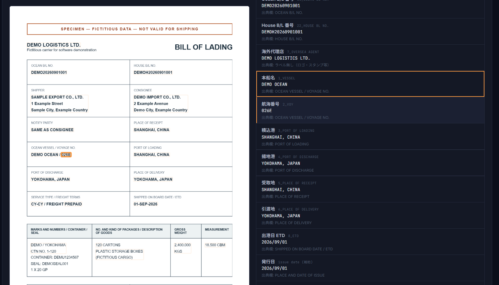

# JOTA｜実務で使うWebアプリの開発・業務自動化

自動車・リース業界の業務管理、グループの運送会社の業務管理に携わり、自社業務で利用するWebアプリを開発・改善しています。

現場の作業を伺い、画面・データ・確認手順・外部サービス連携まで一緒に組み立てます。AI開発支援を活用し、動く画面で確認しながら改善を進めています。

## 予約・稼働管理Webアプリ

キッチンカーの利用日程・条件から空き状況を確認し、仮予約、内容変更、キャンセル、入金確認後の確定、稼働表表示までを扱う業務用アプリです。

- 日程の重なりを確認する予約登録と変更
- 車両・営業許可・関連書類の管理
- 予約やマスタの変更履歴
- Googleスプレッドシートとの連携
- スマートフォン向け下部ナビゲーションと、PC向けの画面配置

使用技術：Next.js、React、TypeScript、CSS、Hono、Cloudflare Pages・D1、Google Apps Script。

日時と空き状況、予約状態の変更、運用担当者の確認手順を扱った経験は、座席予約やイベント受付の設計にも活かせます。車両予約アプリの入金確認は担当者による管理機能です。

## Stripe API連携

Stripeの実装経験があります。請求業務に関連する実装では、テスト環境での商品・税率・顧客・請求書を作成するAPI連携コードを用意しています。

予約管理と決済連携は、それぞれの実績です。座席予約とオンライン決済を一体化したサービスの導入実績として掲載しているものではありません。

## 書類を業務データに変えるAI・OCR

B/L（船荷証券）、請求書、運転日報などを対象に、必要項目の読み取りと業務への取り込みを扱っています。

B/Lでは26列の業務用CSVに対応した仕組みを開発しています。原紙と抽出結果を並べ、読み取り位置を確認できる画面を備えています。原紙との照合や入力ルールのチェックを重視しています。

掲載画像は、架空の会社名・番号を記載したB/Lを実際のアプリで処理したものです。顧客情報は含みません。読み取り結果には確認が必要な項目もあります。

## 継続的な開発・改善の量

2026年9月8日時点で、対象とした12リポジトリのデフォルトブランチをGitHub APIで集計しました。

| 指標 | 件数 |
|---|---:|
| 対象リポジトリ | 12 |
| デフォルトブランチの累計コミット | 1,140 |
| 2026年6月10日00:00 UTC〜9月8日00:00 UTCのコミット | 710 |

対象は、予約・稼働管理、業務ポータル、請求・月次処理、Stripe連携、OCR、業務通知・データ連携などのプロジェクトです。

集計方法は、GitHub GraphQL APIの `defaultBranchRef.target.history.totalCount` です。期間内集計には `since` と `until` を指定しました。対象リポジトリ内の全作者の履歴を含み、実装・修正・文書・設定更新を含みます。AI開発支援による作業も含み、個人の手書きコード量や納品件数を示す数字ではありません。機密保持のため、非公開リポジトリ名や個別履歴は掲載していません。

## 開発の進め方

1. 現在の作業と、改善したい点を整理します。
2. 必要な機能に優先順位を付け、動く画面で確認します。
3. 通常の操作に加え、変更・キャンセル・エラー時の流れを確認します。
4. 利用する担当者の声を聞きながら改善します。

本リポジトリは実績紹介専用です。業務用アプリのソースコード・認証情報・顧客データは含めていません。
